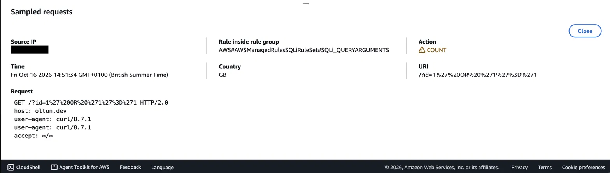
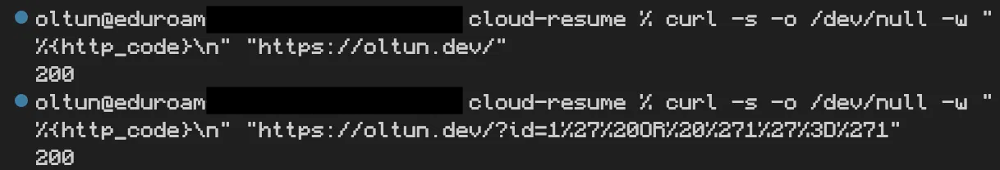
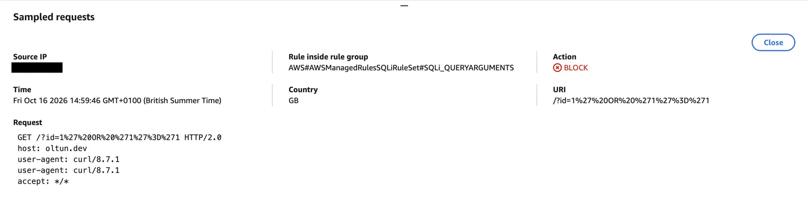
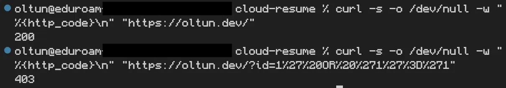
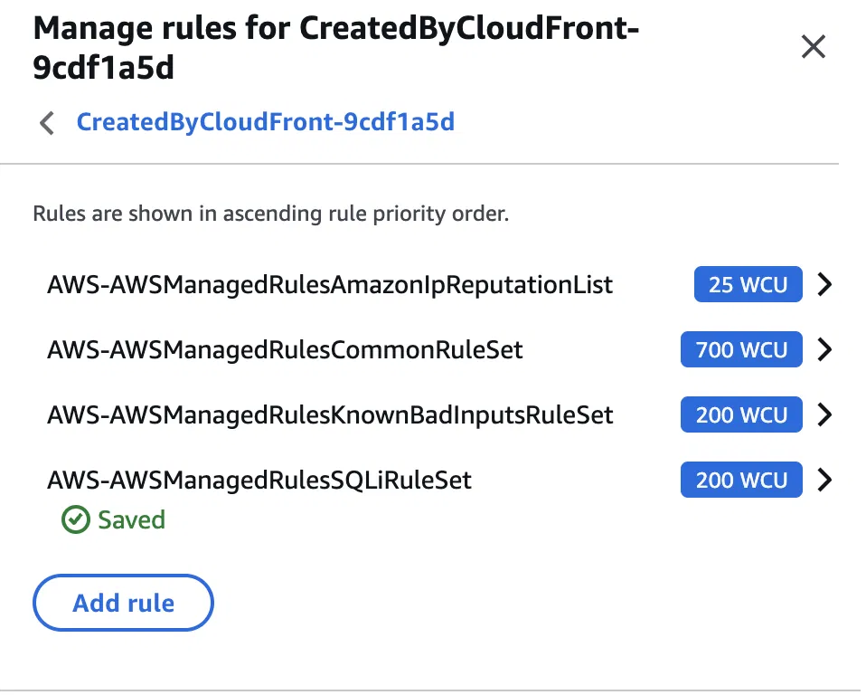
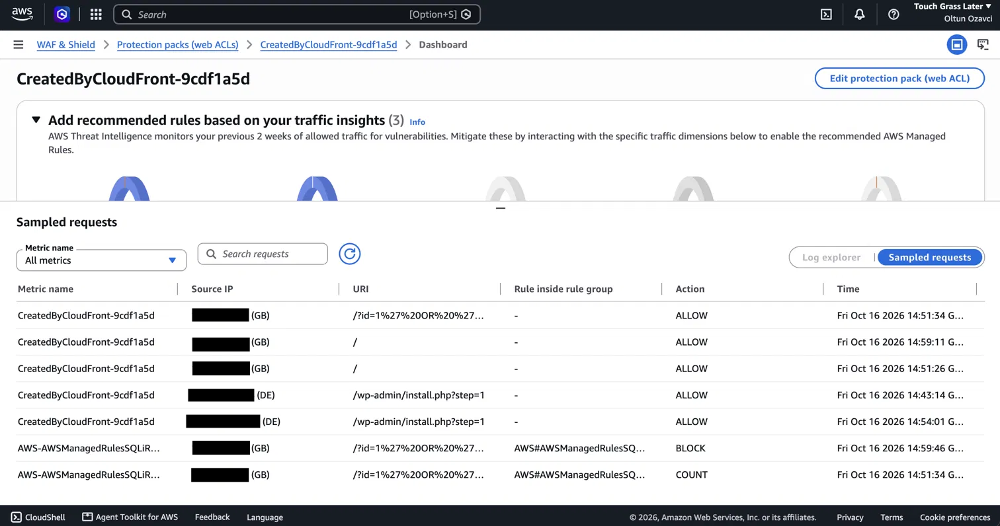

# Secure Cloud Resume

My CV as a static website on AWS, live at **https://oltun.dev**, with a serverless visitor counter.

## Live

- https://oltun.dev
- https://www.oltun.dev

## Architecture

There are two request paths: one serves the page, the other powers the visitor counter.

**1. Serving the page**

```
Visitor
  |  HTTPS (TLS 1.2+)
  v
Cloudflare DNS (records set to "DNS only", traffic is not proxied)
  |
  v
Amazon CloudFront --- ACM certificate (us-east-1, DNS-validated, auto-renewing)
  |  Origin Access Control (signed requests)
  v
Private S3 bucket (eu-north-1, Block Public Access on)
```

**2. Visitor counter**

```
JavaScript on oltun.dev (once per browser session)
  |  POST /visit over HTTPS
  |  CORS allows only https://oltun.dev and https://www.oltun.dev
  v
API Gateway HTTP API (eu-north-1)
  |  route throttle: 1 request/second, burst 2
  v
Lambda function, Python (reserved concurrency: 2)
  |  IAM: dynamodb:UpdateItem on one table only
  v
DynamoDB table (provisioned 1 read / 1 write unit, auto scaling off)
```

*AWS WAF was trialled in front of CloudFront and then removed (see "Security: AWS WAF" below), so it is not part of either path today.*

## What's built so far

**Phase 1: Frontend**
- HTML and CSS CV, previewed locally with VS Code Live Server
- Version-controlled in this repo

**Phase 2: Static hosting and HTTPS**
- Private S3 bucket: Block Public Access on, SSE-S3 encryption, static website hosting off
- CloudFront distribution reading from S3 via Origin Access Control
- HTTP redirected to HTTPS, `index.html` as default root object

**Phase 3: Custom domain and WAF**
- Domain `oltun.dev` registered with Cloudflare Registrar
- Free TLS certificate from AWS Certificate Manager covering `oltun.dev` and `www.oltun.dev`
- Certificate validated with DNS CNAME records in Cloudflare
- Both names attached to the CloudFront distribution as alternate domain names
- DNS records at Cloudflare point the apex and `www` at CloudFront
- AWS WAF trial: SQL injection probe counted in monitor mode, blocked in blocking mode, then decommissioned (see Security section)

**Phase 4: Visitor counter (serverless backend)**
- DynamoDB table holding a single item (`id = "visitors"`) with a `visit_count` number, provisioned at 1 read and 1 write unit with auto scaling off, so capacity is fixed
- Lambda function (Python) that makes one atomic `UpdateItem` call with `ADD` to increment the count and return the new value; errors are logged server-side and the caller only sees a generic error
- Lambda execution role allows `dynamodb:UpdateItem` on that one table and nothing else
- API Gateway HTTP API with one route, `POST /visit`, throttled to 1 request per second (burst 2)
- CORS limited to `https://oltun.dev` and `https://www.oltun.dev`
- Lambda reserved concurrency of 2
- JavaScript in `index.html` calls the API once per browser session (using `sessionStorage`), writes the number with `textContent`, and hides the counter if the call fails, so the CV still loads normally

## Security so far

- The S3 bucket is private; only this CloudFront distribution can read it (OAC)
- Plain HTTP requests are redirected to HTTPS, and the minimum TLS version is 1.2 (`TLSv1.2_2021` policy)
- The certificate auto-renews as long as its validation records stay in DNS
- MFA enabled on the AWS and Cloudflare accounts
- AWS WAF with SQL injection protection: deployed, tested, then decommissioned for cost (see the Security: AWS WAF section)
- The Lambda role follows least privilege: one action, one table
- No request data reaches the database: the Lambda ignores the request body and parameters and always updates the same fixed key, so there is no injection surface in the counter itself
- No AWS credentials exist in the page or the repo; the API endpoint is public by design because browser code has to know it

**Known limits of the counter**
- **CORS is not access control.** It is enforced by browsers, not by the server. I tested with `curl` and a request claiming a disallowed origin still ran and incremented the count; CORS only stopped a browser from reading the reply. The throttle is the real control.
- **Throttling is best-effort.** AWS describes API Gateway throttling as a target, not a guaranteed hard cap. The Lambda concurrency cap, the fixed DynamoDB capacity and the account spend limit sit behind it.
- **The count can be inflated.** Anyone can script calls within the throttle. It is a simple visitor counter, not trustworthy analytics.
- **The API has no WAF in front of it** (see the WAF section below).

## Design decisions and lessons learned

- **Cloudflare DNS instead of Route 53.** Cloudflare Registrar requires Cloudflare's nameservers, so the domain can't use a Route 53 hosted zone without transferring out. The DNS records are "DNS only" so requests go straight to CloudFront and AWS stays the delivery layer.
- **Regions.** My AWS resources live in `eu-north-1`, the Region assigned to my account. CloudFront needs its certificate in `us-east-1`, and the CloudFront domain setup created the ACM certificate there for me.
- **HTTP API instead of REST API.** HTTP APIs cost less per request and include built-in CORS and route-level throttling, which is all this counter needs.
- **Fixed capacity instead of autoscaling.** I wanted a hard ceiling on cost. With provisioned capacity and auto scaling off, DynamoDB can't scale itself up under heavy traffic; excess requests are throttled instead of billed.
- **One atomic write.** A single `UpdateItem` with `ADD` increments and returns the count in one call, so two simultaneous visitors can't both read the same number and overwrite each other.
- **POST, not GET.** The route changes data, so it uses POST. That also stops crawlers from bumping the count with plain GET requests.
- **Once per session.** The page remembers the count in `sessionStorage`, so refreshes don't inflate the number or spend write capacity.
- **Staged limits.** The cost and abuse limits are layered (route throttle, Lambda concurrency cap, fixed DynamoDB capacity, account spend limit) so that no single control is the only thing standing between a traffic flood and the bill.

## Cost

Ongoing cost is the domain (about $12/year at renewal) plus AWS usage, which I expect to be minimal for a CV site.

Cost controls in place:
- A $20/month spend limit on the AWS project, which pauses the project when reached
- A $1 AWS Budgets alert (alerts only; budgets don't set hard limits)
- Fixed DynamoDB capacity, the API throttle and the Lambda concurrency cap described above

The DynamoDB console estimates about $0.63/month for 1 read and 1 write unit before any free tier. AWS's pricing page lists a free tier of 25 provisioned read and write units and 25 GB per Region, so I expect this table to cost nothing. **I have not yet checked this against an actual AWS invoice.**

## Security: AWS WAF (SQL injection testing)

**Status: deployed, tested, and decommissioned on 16 Oct 2026 to avoid ongoing cost.** The live site at oltun.dev is currently **not** behind a WAF. AWS WAF would cost about $8/month for this static site (see Cost below).

### What I built
I attached a web ACL to the CloudFront distribution using the console's one-click protection. It created three AWS managed rule groups:

- `AWSManagedRulesAmazonIpReputationList`: blocks IPs on Amazon's threat-intelligence lists
- `AWSManagedRulesCommonRuleSet`: general web attacks such as XSS and local file inclusion
- `AWSManagedRulesKnownBadInputsRuleSet`: known exploit patterns

None of those is a dedicated SQL injection group, so I added a fourth by hand: `AWSManagedRulesSQLiRuleSet`.

### How I tested it
I ran the same two requests in two modes: a normal page load, and a classic SQL injection probe (`' OR '1'='1`, URL-encoded) in the query string.

```
curl -s -o /dev/null -w "%{http_code}\n" "https://oltun.dev/"
curl -s -o /dev/null -w "%{http_code}\n" "https://oltun.dev/?id=1%27%20OR%20%271%27%3D%271"
```

| Mode | Normal page | SQL injection probe |
|---|---|---|
| Monitor (Count) | 200 | 200, matched and counted by `SQLi_QUERYARGUMENTS` |
| Blocking | 200 | **403**, blocked by `SQLi_QUERYARGUMENTS` |

Monitor mode:



Blocking mode:



All four rule groups, and the full sampled-requests view:



### What I learned
- **Monitor mode first.** It records what a rule would block without blocking it, which is the safe way to test a WAF before enforcing it.
- **The 403 alone isn't proof.** A private S3 bucket also returns 403 for missing paths, so I confirmed the block from WAF's sampled requests, which name the exact rule.
- **CloudFront manages its one-click web ACL.** My manually added SQL rule group disappeared after I saved the CloudFront security settings (probably because CloudFront re-applied its own configuration), so I re-added it in the WAF console.
- **A WAF is one layer, not a shield.** Within minutes of the WAF going live, automated scanners probed for `/wp-admin/install.php`. The WAF allowed those requests, because they match no attack rule. The site isn't WordPress, so there was nothing there to exploit.
- **Limits of my test.** I tested a single, simple, URL-encoded probe against the query string. I did not test encoding tricks or other injection points. SQL injection protection matters where input reaches a database. The visitor-counter API now exists, but it ignores request data entirely and DynamoDB isn't a SQL database, so there is little to inject into. The API is not behind a WAF. Whether and how to put one in front of it (for example, CloudFront in front of the API) is something I have not evaluated or verified.

### Cost
The one-click setup was estimated at $8.01/month at 10,000 requests/month (web ACL plus three rule groups plus request charges), and the extra SQL rule group adds roughly $1/month. WAF is billed hourly, at roughly a cent an hour on those figures, and it ran for about 30 minutes, so by arithmetic the trial should have cost a cent or two. That is an estimate from AWS's pricing; I have not checked it against the invoice. I decommissioned it because the monthly cost is hard to justify for a static CV. I disabled the protection in CloudFront, and verified in the WAF console that no web ACL remained.

### Alternatives considered
- **Cloudflare WAF:** free tier, but not open source, and it would put a second CDN in front of CloudFront.
- **Open-source WAF (ModSecurity or Coraza with the OWASP Core Rule Set):** needs a server in the request path, which CloudFront and S3 can't host. It could only be added as a lab or extra EC2 cost, so I haven't deployed it.

## Roadmap

- [x] Frontend (HTML/CSS)
- [x] Private S3 bucket and CloudFront with HTTPS
- [x] Custom domain with TLS certificate
- [x] AWS WAF with SQL injection protection: deployed, tested, decommissioned (see Security section)
- [x] Visitor counter (API Gateway, Lambda, DynamoDB)
- [ ] CI/CD with GitHub Actions (the Lambda source currently lives only in the AWS console and will move into this repo)
- [ ] Write-up and blog post
- [ ] Restyle the site (the counter's position is temporary, and a favicon is missing, so browsers' automatic favicon request returns a harmless 403)